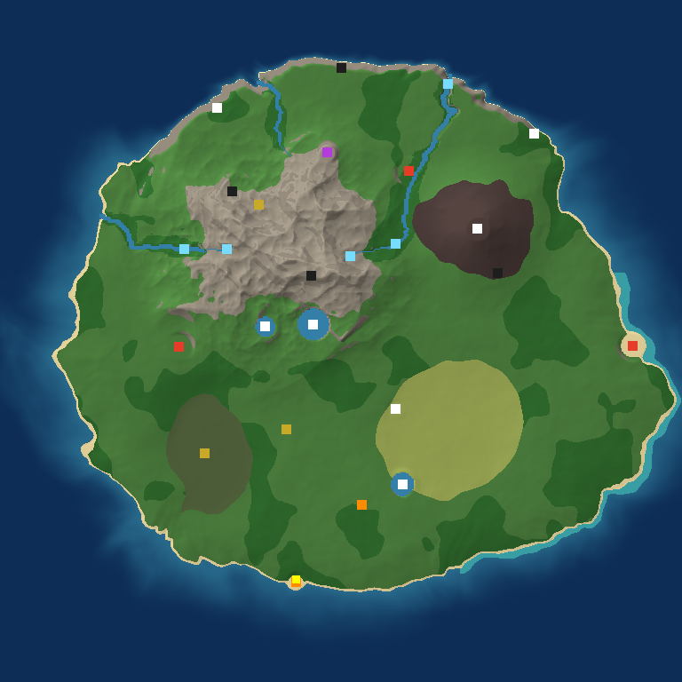

# ISLAND UNTAMED

Survival de mundo abierto en **Unreal Engine 5** (C++). Un avión cae en una tormenta; el
superviviente despierta en una isla generada proceduralmente, habitada por tres tribus con
culturas, normas y relaciones propias. Hay que sobrevivir, construir, cultivar, pescar, cazar,
explorar cuevas y ruinas y descubrir qué es la luz azul bajo el volcán.



> Mapa real generado por `Tests/IslandPreview` con la semilla del juego: costa norte de
> acantilados, cordillera, volcán (noreste), pantano (suroeste), llanuras (sureste), 3 ríos con
> cascadas, 3 lagos, 3 aldeas (rojo), ruinas (amarillo), cuevas (negro), estación Meridian
> (morado), restos del avión (naranja) y punto de inicio (amarillo, sur).

---

## Estado real del proyecto (léelo primero)

| Parte | Estado |
|---|---|
| **Núcleo de simulación** (`Source/IslandUntamed/Sim/`, C++ puro) | **Compilado y probado**: 22 pruebas y 2639 comprobaciones pasan con clang 18 y gcc 13, con flags equivalentes a los de UE (`-fno-exceptions -fno-rtti -Wshadow -Werror`, compilación unificada). |
| **Datos del juego** (`Content/Data/*.json`) | Validados por las pruebas (referencias cruzadas, densidades y recetas). |
| **Capa Unreal Engine 5** (actores, componentes, IA, HUD…) | **Escrita pero NO compilada**: en el entorno de desarrollo no había Unreal Engine (el código fuente de Epic es privado y no hay GPU). Se ha revisado a mano, pero hay que compilarla en una máquina con UE 5.4 o superior, y lo normal es que haya que corregir algunos errores de compilación. |
| **Ejecutable** | No generado (requiere UE instalado). |

Nada de lo descrito como «terminado» en `Docs/DEVLOG.md` se ha visto funcionar dentro de UE.
Lo que sí está demostrado es la lógica de juego (simulación) y el generador del mundo.

---

## Cómo abrirlo

Requisitos: Unreal Engine **5.4+** (probado conceptualmente contra la API de 5.4/5.5), Visual
Studio 2022 o Rider (Windows) / clang (Linux), GPU compatible con DX12/SM6 para Lumen (opcional:
el juego baja la calidad automáticamente).

1. Clic derecho en `IslandUntamed.uproject` → **Generate Visual Studio project files**.
2. Abre `IslandUntamed.sln` y compila **Development Editor | Win64**.
3. Abre el proyecto en el editor. (Opcional pero recomendado) ejecuta
   `Tools > Execute Python Script > Scripts/setup_content.py` para crear los materiales del
   proyecto: vegetación con viento, agua, terreno y vista previa translúcida de construcción.
   Sin ellos el juego funciona con los materiales básicos del motor.
4. Pulsa **Play** (el mapa por defecto es `/Engine/Maps/Entry`: la isla se genera al iniciar).
5. Para un ejecutable: `Platforms > Windows > Package Project` (los JSON se empaquetan con
   `DirectoriesToAlwaysStageAsUFS=Data`).

Pruebas del núcleo (sin Unreal):

```bash
cmake -S Tests -B build/tests -DCMAKE_BUILD_TYPE=Release
```

```bash
cmake --build build/tests -j
```

```bash
./build/tests/IslandSimTests
```

```bash
./build/tests/IslandPreview island.ppm 1024
```

Pruebas dentro del motor: `Session Frontend > Automation > IslandUntamed.*`.

## Controles

| Acción | Teclado/ratón | Mando |
|---|---|---|
| Moverse / mirar | WASD / ratón | Stick izq. / der. |
| Correr / saltar / agacharse | Shift / Espacio / Ctrl | L3 / A / R3 |
| Atacar, recolectar, usar | Clic izquierdo | RT |
| Bloquear / cancelar | Clic derecho | LT |
| Interactuar / acción secundaria | E / F | X / Y |
| Esquivar | Alt | B |
| Barra rápida | 1-8 / rueda | — |
| Inventario / fabricar / construir | Tab / C / B | Select / — / Cruceta ↑ |
| Mapa / diario | M / J | Cruceta → / ← |
| Rotar pieza / desmontar | R / X | RB / Cruceta ↓ |
| Guardado rápido / cargar última | F5 / F9 | — |
| Pausa | Esc | Start |

## Documentación

- `Docs/ARCHITECTURE.md`: arquitectura técnica y decisiones.
- `Docs/DEVLOG.md`: registro de la jornada, funciones terminadas, pendientes y problemas.
- `Docs/GAME_DESIGN.md`: historia, tribus, progresión y plan de contenido.
