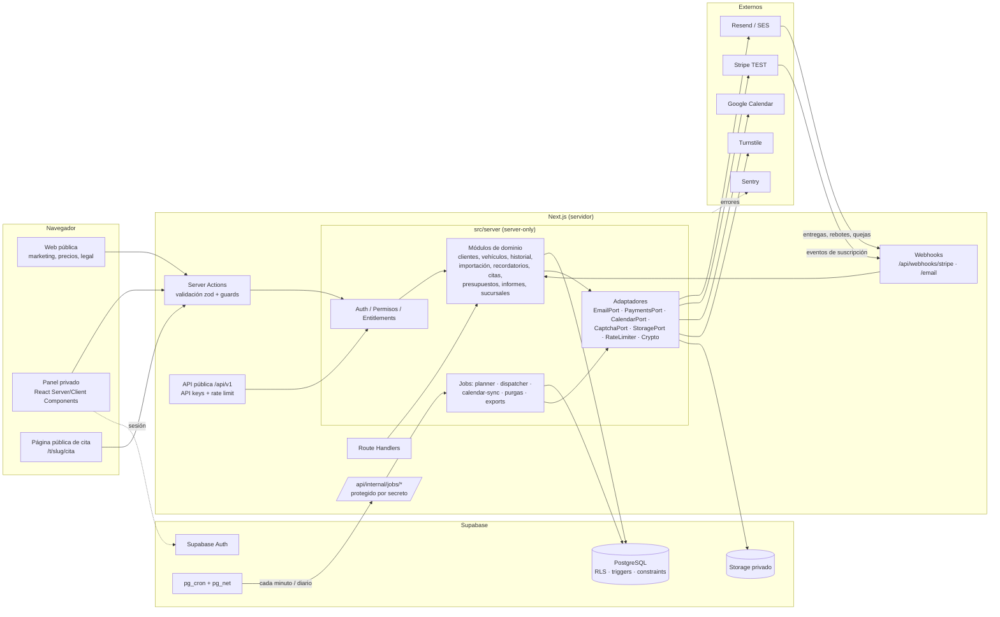

# RevisaYa — Arquitectura

> Estado: **diseño (Fase 0)**. Pendiente de aprobación antes de la Fase 1.
> Documentos relacionados: [BASE-DE-DATOS](BASE-DE-DATOS.md) · [SEGURIDAD](SEGURIDAD.md) · [AUTOMATIZACIONES](AUTOMATIZACIONES.md) · [DECISIONES-TECNICAS](DECISIONES-TECNICAS.md)

## 1. Principios

1. **La base de datos es la última línea de defensa.** Aislamiento multi-tenant (RLS), coherencia entre organización/sucursal/cliente/vehículo (claves foráneas compuestas) y límites de plan (triggers con bloqueo) se garantizan en PostgreSQL, no solo en la aplicación.
2. **Toda la lógica de negocio vive en el servidor.** El navegador nunca habla directamente con las tablas de datos: usa Server Actions y Route Handlers que validan (zod), autorizan (roles/permisos/plan) y ejecutan.
3. **Puertos y adaptadores** para todo proveedor externo (email, pagos, calendario, captcha, almacenamiento, rate limiting). Cambiar Resend por SES no toca la lógica de recordatorios.
4. **Trabajo pesado fuera de la petición HTTP.** Recordatorios, envíos, sincronización de calendario, confirmación de importaciones grandes, exportaciones y purgas se ejecutan en procesos de fondo con cola en PostgreSQL.
5. **Idempotencia por diseño.** Cada operación repetible (webhook, envío, planificación, importación) tiene una clave única en la base de datos que impide duplicados aunque se ejecute dos veces.
6. **Nada simulado en producción.** Los adaptadores "falsos" solo existen en tests; en ejecución, si falta una credencial, la funcionalidad aparece como *no configurada* y lo dice.

## 2. Stack seleccionado

| Capa | Tecnología | Motivo |
|---|---|---|
| Framework | **Next.js 16 (App Router) + React 19 + TypeScript estricto** | Server Components, Server Actions con protección de origen incorporada, Route Handlers para webhooks/API. |
| Estilos/UI | **Tailwind CSS v4**, primitivas accesibles Radix (vía shadcn/ui como punto de partida, con sistema de diseño propio), TanStack Table, Recharts, sonner | Componentes reutilizables y accesibles sin aspecto de plantilla. |
| Formularios | react-hook-form + **zod** (esquemas compartidos cliente/servidor) | La misma validación en ambos lados; el servidor siempre revalida. |
| Base de datos | **Supabase PostgreSQL en región UE** (pg_cron, pg_net, pg_trgm, citext) | Postgres estándar, RLS, backups gestionados; el PDF pide preferir servidores en la UE. |
| Acceso a datos | **Kysely** (SQL tipado) sobre conexión Postgres con **contexto RLS por transacción** | Transacciones reales en TypeScript sin perder RLS. Ver ADR-003. |
| Migraciones | **Supabase CLI** (`supabase/migrations/*.sql`), tipos generados con `kysely-codegen` | El SQL versionado es la fuente de verdad. |
| Auth | **Supabase Auth** (`@supabase/ssr`, cookies httpOnly) | Registro, verificación email, recuperación, sesiones, contraseñas con hash (bcrypt) gestionadas por Supabase. |
| Almacenamiento | **Supabase Storage** (buckets privados, rutas por organización) | Logos, archivos de importación, PDFs, exportaciones RGPD. |
| Email | **Resend** (adaptador principal) · Amazon SES (adaptador alternativo) | API de dominios, webhooks firmados, claves de idempotencia. |
| Pagos | **Stripe** (Checkout, Customer Portal, Billing, Tax) en **modo TEST** | Suscripciones mensual/anual, prueba, cambios de plan. |
| Calendario | **Google Calendar API** (OAuth 2.0, `googleapis`) | Desde plan Max. |
| PDF | **@react-pdf/renderer** | Generación en servidor sin navegador headless. |
| Excel/CSV | **ExcelJS** (.xlsx) + **PapaParse** (.csv) | Ver ADR-008 (se descarta el paquete `xlsx` de npm por vulnerabilidades sin parchear en npm). |
| Decimales | **decimal.js** + `numeric(12,2)` en BD | Sin errores de coma flotante. |
| Anti-spam | **Cloudflare Turnstile** + rate limiting + honeypot | Formularios públicos (cita, contacto, registro). |
| Observabilidad | **Sentry** (errores), logs estructurados (pino) con redacción de datos sensibles, tabla `job_runs`, *dead-man switch* externo (p. ej. healthchecks.io) | Detectar que el proceso diario no se ejecutó. |
| Hosting | **Vercel Pro** (web) + **Supabase Pro** (BD) | Vercel Hobby no permite uso comercial. Alternativa sin lock-in: contenedor Node en Railway/Fly/Render. |
| Testing | Vitest, **pgTAP** (`supabase test db`), Playwright, MSW, Stripe CLI | Ver [TESTING](TESTING.md). |

## 3. Diagrama de componentes



## 4. Estructura del repositorio (propuesta)

```
/
├─ src/
│  ├─ app/
│  │  ├─ (marketing)/            # inicio, cómo funciona, funcionalidades, precios, FAQ, contacto, legal
│  │  ├─ (auth)/                 # login, registro, verificar, recuperar, invitación
│  │  ├─ (app)/app/              # panel: dashboard, clientes, vehículos, historial, recordatorios,
│  │  │                          # correos, citas, presupuestos, informes, usuarios, sucursales,
│  │  │                          # integraciones, configuración, suscripción
│  │  ├─ t/[slug]/cita/          # solicitud pública de cita
│  │  ├─ baja/[token]/           # baja de avisos (one-click unsubscribe)
│  │  └─ api/
│  │     ├─ v1/                  # API pública versionada (Excelencia)
│  │     ├─ webhooks/stripe/     # firma verificada, idempotente
│  │     ├─ webhooks/email/      # firma verificada, idempotente
│  │     ├─ oauth/google/        # callback OAuth
│  │     └─ internal/jobs/       # disparadores de cron (secreto + comparación en tiempo constante)
│  ├─ server/                    # import 'server-only' en cada módulo
│  │  ├─ db/                     # Kysely, withRls(), withSystem(), tipos generados
│  │  ├─ auth/                   # getSession, requireMember, requireRole, requirePermission
│  │  ├─ entitlements/           # planes, límites y features: fuente única para app y BD
│  │  ├─ modules/<modulo>/       # schema.ts · service.ts · repository.ts · actions.ts · policy.ts
│  │  ├─ jobs/                   # planner, dispatcher, cola, lease, backoff
│  │  └─ adapters/               # email/, payments/, calendar/, captcha/, storage/, crypto/, ratelimit/
│  ├─ components/                # ui/ (sistema de diseño), app/, marketing/
│  ├─ emails/                    # plantillas React Email (layout corporativo)
│  └─ lib/                       # funciones puras compartidas: plate, plans (catálogo público), money, dates, template-vars
├─ supabase/
│  ├─ config.toml
│  ├─ migrations/                # SQL versionado (nunca destructivo sin autorización)
│  ├─ seed.sql                   # SOLO desarrollo local
│  └─ tests/                     # pgTAP: RLS, constraints, límites, idempotencia
├─ tests/                        # unit/, integration/, e2e/
└─ docs/
```

Regla de capas: `app/` → `server/modules/*/actions` → `service` → `repository` → `db`. Los servicios no importan Next; así los jobs y la API reutilizan exactamente la misma lógica (sin duplicar).

## 5. Modelo de tenencia

```
Organización (cuenta de facturación, = tenant)
 ├─ Suscripción / plan / consumo
 ├─ Miembros (admin | operario) con alcance: todas las sucursales o algunas
 └─ Sucursales (taller). Pro y Max: 1 sucursal creada automáticamente.
     └─ Clientes → Vehículos → Historial, Recordatorios, Citas, Presupuestos
```

- Cada fila de datos lleva `organization_id` **y** `branch_id`. Las claves foráneas compuestas garantizan que un vehículo solo puede apuntar a un cliente de la **misma organización y sucursal**.
- Un plan Pro es simplemente una organización con una sucursal: pasar a Business no requiere migrar datos.
- El administrador con alcance "todas" ve datos agregados entre sucursales (informes conjuntos); los registros nunca se mezclan.

## 6. Flujo de una petición autenticada

1. `proxy`/middleware refresca la sesión de Supabase (cookies httpOnly, `SameSite=Lax`).
2. La Server Action valida la entrada con zod.
3. `requirePermission(orgId, 'customers.write')` comprueba en BD que el usuario es miembro activo, su rol/permisos y su alcance de sucursal. **El `organization_id` nunca se toma del cliente sin verificar pertenencia**; la organización activa se resuelve desde la sesión + cookie de selección validada contra `organization_members`.
4. `entitlements.assert(orgId, 'customers.create')` comprueba plan y estado de suscripción (la BD lo vuelve a comprobar en el trigger).
5. `withRls(user, tx => ...)` abre una transacción con `set local role authenticated` y los claims del JWT verificado: RLS se aplica también a las consultas del servidor (defensa en profundidad).
6. Se registra auditoría de acciones críticas y se devuelve un resultado tipado `{ ok, data } | { ok:false, error:{ code, message, fieldErrors } }`.

## 7. Flujos clave (detalle en documentos específicos)

- **Recordatorios**: planner diario por zona horaria → filas `reminders` idempotentes → dispatcher cada minuto con `FOR UPDATE SKIP LOCKED`, lease y backoff → webhook de entrega. Ver [AUTOMATIZACIONES](AUTOMATIZACIONES.md).
- **Importación**: subida → staging (`import_batches`/`import_rows`) → corrección → confirmación atómica en una única transacción. Ver [IMPORTACION](IMPORTACION.md).
- **Suscripciones**: Checkout → webhook firmado → `subscriptions` (solo escribe el webhook). Ver [INTEGRACIONES](INTEGRACIONES.md).
- **Citas**: enlace con token único en el correo → página pública → solicitud (`requested`) → el taller confirma/rechaza/reprograma → sincronización Google Calendar (Max+).

## 8. Escalabilidad

| Escala | Qué cambia |
|---|---|
| 100–1.000 talleres | Arquitectura base. Supabase Pro Micro/Small. Dispatcher en Route Handler invocado cada minuto. |
| 1.000–5.000 | Subir cómputo de Postgres, réplica de lectura para informes, rate limiting en Redis (Upstash), lotes del dispatcher en paralelo con reparto justo por organización. |
| > 10.000 | Worker Node dedicado (mismo código de `server/jobs`) en contenedor, particionado mensual de `email_logs`/`audit_logs`/`reminders`, vistas materializadas para informes, SES como proveedor por coste. |

Medidas desde el día uno: paginación en servidor (keyset en tablas grandes), índices que empiezan por `organization_id`, consultas con joins en vez de N+1, procesamiento por lotes, límites de tamaño en todas las entradas.
