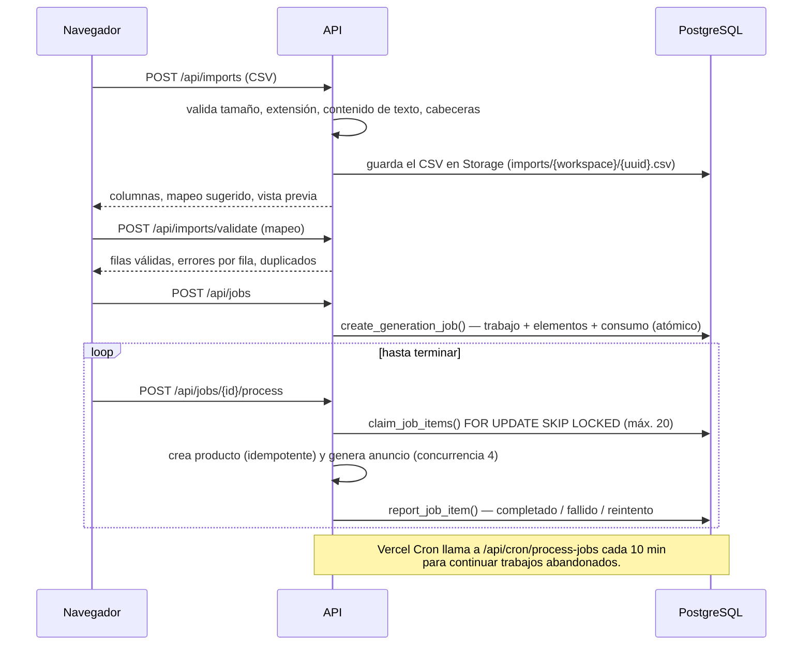

# Arquitectura

## Visión general

AnunciaPro es una aplicación **Next.js 16 (App Router)** desplegable en Vercel o en cualquier servidor Node.js. El frontend y el backend viven en el mismo proyecto; la persistencia, la autenticación y los archivos los proporciona **Supabase** (PostgreSQL 17 + Auth + Storage).

```mermaid
flowchart LR
  subgraph Navegador
    UI[Páginas React<br/>Server + Client Components]
  end
  subgraph "Next.js (Vercel / Node)"
    P[proxy.ts<br/>refresco de sesión y<br/>primera barrera de rutas]
    RSC[Server Components<br/>requireSession / requireAdminPage]
    API[Route Handlers /api<br/>route(): origen + rate limit + errores]
    SVC[server/services<br/>lógica de aplicación]
    DOM[domain/<br/>lógica pura: generación,<br/>categorías, planes, CSV, marketplaces]
    BILL[server/billing/stripe]
  end
  subgraph Supabase
    AUTH[Auth<br/>JWT + cookies httpOnly]
    PG[(PostgreSQL<br/>RLS + funciones SQL)]
    ST[(Storage<br/>buckets privados)]
  end
  STRIPE[Stripe<br/>desactivado por defecto]
  AI[Proveedor de IA opcional<br/>Anthropic]
  CRON[Vercel Cron]

  UI --> P --> RSC
  UI -- fetch JSON --> API
  RSC --> SVC
  API --> SVC --> DOM
  SVC -- cliente con sesión del usuario (RLS) --> PG
  SVC --> ST
  SVC -. service_role solo en admin, webhooks, cron .-> PG
  RSC --> AUTH
  API --> BILL --> STRIPE
  STRIPE -- webhooks firmados --> API
  DOM -. si AI_PROVIDER=anthropic .-> AI
  CRON -- Bearer CRON_SECRET --> API
```

## Capas

| Capa | Ubicación | Responsabilidad |
|---|---|---|
| Componentes visuales | `src/components/ui`, `src/components/{app,admin,marketing,forms}` | Presentación. Sin acceso a datos ni reglas de negocio. |
| Páginas | `src/app/**/page.tsx` | Server Components: obtienen la sesión, llaman a servicios y componen la UI. |
| API | `src/app/api/**/route.ts` | Route Handlers finos: validan con Zod, llaman a un servicio y responden. |
| Servicios | `src/server/services` | Casos de uso: productos, anuncios, generación, trabajos, plantillas, cuenta, administración, estadísticas. |
| Dominio | `src/domain` | Reglas puras y deterministas, sin framework: generador, perfiles de marketplace, atributos, planes, importación CSV, exportación. Totalmente cubiertas por pruebas unitarias. |
| Acceso a datos | `src/lib/supabase` + funciones SQL | Clientes tipados (`database.types.ts`); las operaciones críticas (consumo, trabajos) son funciones PL/pgSQL atómicas. |
| Validación | `src/validation/schemas.ts` | Esquemas Zod compartidos por formularios (cliente) y API (servidor). |
| Autenticación y permisos | `src/server/auth/session.ts`, `proxy.ts`, políticas RLS | Identidad siempre desde la sesión verificada; autorización en servidor **y** en la base de datos. |
| Integraciones externas | `src/server/billing/stripe.ts`, `src/domain/generation/anthropic-provider.ts` | Aisladas tras interfaces; inertes si no están configuradas. |
| Configuración | `src/lib/config/env*.ts` | Variables validadas con Zod; las opcionales solo se exigen al activar su funcionalidad. |

## Decisiones técnicas

1. **Supabase con RLS como última línea de defensa.** El servidor usa el cliente con la sesión del usuario, por lo que una consulta mal filtrada en el código sigue sin poder leer datos de otro espacio. La clave `service_role` solo se usa en administración, webhooks, cron, devolución de cuota, limitación de peticiones y eliminación de cuentas.
2. **Workspaces desde el primer día.** Todos los datos cuelgan de `workspace_id`. Hoy cada usuario tiene un espacio propio; los roles (`owner`, `admin`, `editor`, `viewer`) y las políticas ya contemplan equipos.
3. **Claves foráneas compuestas** `(product_id, workspace_id)` en anuncios, imágenes y versiones: es imposible en la base de datos asociar un anuncio a un producto de otro espacio.
4. **Atributos dinámicos en JSONB** con definiciones en `category_attributes`: añadir una categoría o un atributo es un `INSERT`, sin migración de esquema.
5. **Consumo atómico en PostgreSQL.** `consume_usage` y `create_generation_job` bloquean la fila de suscripción del espacio (`SELECT … FOR UPDATE`), comprueban el límite e insertan el registro en la misma transacción, con clave de idempotencia única.
6. **Procesamiento por lotes sin colas externas.** Ver más abajo.
7. **Generación determinista por defecto.** El modo de plantillas no tiene coste ni dependencias y es 100 % verificable. La IA es opcional y se presenta como tal.
8. **Route Handlers + `fetch` en lugar de Server Actions** para las mutaciones: contrato HTTP explícito, fácil de probar y reutilizable como base de una API pública futura.
9. **Sin estado global en cliente.** El estado vive en la URL (filtros, página, vista) y en el servidor; los formularios usan React Hook Form. No hace falta ninguna librería de estado.

## Motor de generación

```
domain/generation/
  types.ts               Contrato GenerationProvider + GenerationSystemError
  copy.ts                Banco de redacción: frases por tipo de producto, estado y tono
  template-provider.ts   Plantillas y reglas (por defecto, sin IA)
  anthropic-provider.ts  Proveedor de IA (salida estructurada validada con Zod)
  registry.ts            Selección según AI_PROVIDER
```

- **Entrada**: `GenerationProduct` construido en servidor solo con datos del producto guardado (incluidos atributos resueltos con unidades y atributos obligatorios ausentes).
- **Salida**: título, descripción completa y breve, características destacadas, puntos de venta, palabras clave, información del estado, CTA, información que falta y avisos.
- **Reglas que no dependen del proveedor**: los defectos se incluyen siempre; los límites de la plataforma se aplican con `adaptListing`; la información ausente y el texto del estado se calculan con reglas locales también cuando se usa IA.
- **Redacción natural sin inventar**: `copy.ts` convierte los atributos en frases («128 GB de almacenamiento y color azul»), coloca la marca según la categoría y elige entre alternativas con una semilla determinista: dos productos no se leen igual y «Volver a generar» (`variation`) ofrece otro texto con los mismos datos. Una matriz de pruebas recorre todos los tonos, extensiones, variaciones y plataformas verificando que no aparece ningún hecho no aportado.
- **Medidor de calidad** (`domain/quality.ts`): puntuación 0–100 con comprobaciones objetivas (longitudes, precio, fotos, datos clave, transparencia del estado) que se recalcula en el navegador mientras se edita.
- **Añadir un modelo**: implementar `GenerationProvider` y registrarlo en `registry.ts`. Las claves nunca llegan al navegador.
- **Errores**: un fallo del proveedor lanza `GenerationSystemError`; el servicio devuelve la cuota consumida (`refund_usage`).

## Adaptadores de marketplace

`domain/marketplaces/profiles.ts` define perfiles con límites de caracteres, estructura de título, formato (texto/HTML), número de palabras clave, hashtags, campos habituales y reglas. Las plantillas del usuario (`templates.configuration`) sobrescriben esos valores. `adapt.ts` recorta y reformatea sin añadir información; `export.ts` produce TXT, CSV, JSON y CSV de productos para Shopify.

Para integrar una API oficial en el futuro se añadiría un adaptador de publicación (por ejemplo `domain/marketplaces/publishers/<plataforma>.ts`) que reciba un `ListingContent` ya adaptado, con sus credenciales OAuth guardadas por espacio de trabajo. La arquitectura actual no publica nada.

## Generación masiva



- Ninguna petición procesa más de 20 elementos: se respetan los límites de tiempo de las funciones serverless.
- Los resultados correctos se guardan al momento; un fallo posterior no los pierde.
- Errores del sistema: el elemento vuelve a la cola (máx. 3 intentos); al terminar, la cuota de los fallidos por el sistema se devuelve automáticamente.
- Elementos bloqueados por un proceso que murió se recuperan pasados 5 minutos.
- Duplicados: se eliminan dentro del CSV (SKU o nombre+marca+modelo) y un SKU ya existente en el catálogo reutiliza el producto.
- Reintento manual de fallidos: vuelve a reservar consumo para esos elementos.

## Preparado para el futuro

| Ampliación | Punto de extensión |
|---|---|
| Reconocimiento de productos por foto / visión artificial | Nuevo método en `GenerationProvider` que reciba imágenes (ya están en Storage, ligadas al producto) |
| Traducción automática | `language` ya existe en anuncios y perfiles; un proveedor puede traducir `ListingContent` |
| Cálculo de márgenes y comparación de precios | `cost_price` y margen estimado ya existen |
| Detección de duplicados | Índice trigram sobre `products.name` ya creado |
| API pública | Los Route Handlers ya exponen contratos JSON; faltaría autenticación por clave de API |
| Equipos más amplios (SSO, permisos por recurso) | Ya existen invitaciones, roles y cambio de espacio; los roles viven en `workspace_members` |
| Sincronización de inventario / integraciones oficiales | Adaptadores de publicación (ver arriba) |
