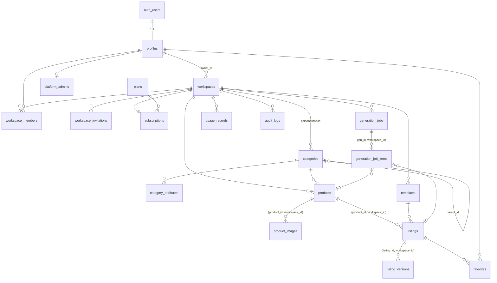

# Base de datos

PostgreSQL 17 gestionado por Supabase. Identificadores UUID, fechas `timestamptz` (UTC), restricciones `CHECK` en todos los campos acotados e índices para las consultas frecuentes.

## Migraciones

| Archivo | Contenido |
|---|---|
| `20261110000100_core_schema.sql` | Tablas, claves foráneas (incluidas compuestas), índices, triggers de `updated_at` y versionado de anuncios |
| `20261110000200_functions_and_rls.sql` | Funciones de autorización, alta de usuarios, consumo atómico, trabajos masivos, rate limit, auditoría, estadísticas, triggers de integridad, **RLS** y privilegios |
| `20261110000300_storage.sql` | Buckets privados y políticas de Storage |
| `20261110000400_reference_data.sql` | Planes (Free, Starter, Pro, Business), 53 categorías y 103 atributos |
| `20261110000500_contact_messages.sql` | Mensajes del formulario de contacto |
| `20261113000600_teams.sql` | Invitaciones, gestión de miembros y límite de miembros por plan |
| `20261113000700_rls_performance.sql` | Políticas RLS basadas en conjuntos (una evaluación por consulta), índices y estadísticas optimizadas |

Las siete migraciones se han aplicado y probado en la base de datos **local** (`supabase db reset`). En un proyecto de Supabase en la nube **no se han aplicado**: hay que hacerlo con `pnpm db:push` (ver DESPLIEGUE.md).

## Diagrama de relaciones

## Tablas

| Tabla | Propósito | Notas |
|---|---|---|
| `profiles` | Datos del usuario (1:1 con `auth.users`) | Contraseñas solo en Supabase Auth. `disabled_at` lo gestiona administración. Los usuarios solo pueden editar `full_name`, `avatar_url`, `onboarding_completed_at` (privilegios por columna). |
| `platform_admins` | Administradores de plataforma | Sin políticas RLS: inaccesible para usuarios. Solo `service_role`. |
| `workspaces`, `workspace_members` | Espacios y membresías con rol | Un único `owner` por espacio (índice parcial único). |
| `categories`, `category_attributes` | Categorías del sistema (`workspace_id` nulo) y personalizadas | Máximo dos niveles. `attribute_type`: text, number, select, boolean. |
| `products` | Catálogo | `attributes`, `features` en JSONB. SKU único por espacio. Índices por espacio+fecha, categoría, archivo y trigram por nombre. |
| `product_images` | Metadatos de fotos | Ruta única, MIME y tamaño acotados. |
| `templates` | Plantillas personalizadas | `configuration` JSONB que sobrescribe el perfil base. |
| `listings` | Anuncios | Estados `draft`, `ready`, `archived`. `current_version` lo gestiona un trigger. |
| `listing_versions` | Historial inmutable | Una versión por cada cambio de contenido; solo lectura para usuarios. |
| `favorites` | Favoritos por usuario | Único `(user_id, listing_id)`. |
| `generation_jobs`, `generation_job_items` | Trabajos masivos | Contadores coherentes por `CHECK` (`successful + failed = processed ≤ total`). |
| `usage_records` | Consumo | Clave de idempotencia única por espacio. Las devoluciones son registros negativos (`refund`). |
| `plans`, `subscriptions` | Planes configurables y suscripción por espacio | Límites en columnas y en `features` JSONB. |
| `stripe_events` | Idempotencia de webhooks | Estado `processing`/`processed`/`failed`. |
| `audit_logs` | Auditoría | Lectura para propietarios del espacio y administración. |
| `rate_limit_buckets` | Limitación de peticiones compartida entre instancias | Solo `service_role`. |
| `workspace_invitations` | Invitaciones pendientes a un espacio | Enlace con token secreto; única por espacio y correo; caduca a los 14 días. Solo se escribe mediante funciones. |
| `contact_messages` | Formulario de contacto | Escritura solo mediante función; lectura solo `service_role`. |

## Funciones principales

| Función | Quién la usa | Qué garantiza |
|---|---|---|
| `handle_new_user()` (trigger) | Auth | Perfil + espacio + membresía de propietario + suscripción Free en la misma transacción |
| `user_workspace_ids(rol_mínimo)` | Políticas RLS | Conjunto de espacios del usuario (se evalúa una vez por consulta); excluye cuentas desactivadas |
| `is_workspace_member`, `can_edit_workspace`, `can_manage_workspace` | Funciones de negocio y Storage | Pertenencia y rol; excluyen cuentas desactivadas |
| `invite_member`, `accept_invitation`, `revoke_invitation`, `decline_invitation`, `set_member_role`, `remove_member` | Equipo | Permisos por rol, límite de miembros del plan (atómico) y aceptación solo por el correo invitado |
| `workspace_plan`, `workspace_usage_period`, `workspace_usage_state` | Internas | Plan vigente (Free si la suscripción no da acceso) y periodo: mes natural UTC o periodo de facturación de Stripe |
| `consume_usage(workspace, op, key)` | Generación individual | Atómica, idempotente, nunca supera el límite |
| `refund_usage(workspace, key)` | Servidor (`service_role`) | Devolución única por errores del sistema |
| `create_generation_job(...)` | Importación | Valida plan, filas máximas, cuota masiva y mensual, trabajos activos (≤3) y reserva el consumo |
| `claim_job_items(job, limit)` | Procesamiento | `FOR UPDATE SKIP LOCKED`, recuperación de bloqueos caducados |
| `report_job_item(...)` | Procesamiento | Idempotente; reintentos de errores del sistema (máx. 3); actualiza contadores |
| `refresh_generation_job(job)` | Interna | Estado final y devolución de cuota de fallos del sistema |
| `retry_failed_job_items(job)` | Usuario | Reintento con nueva reserva de consumo |
| `get_dashboard_stats(workspace)` | Panel | `SECURITY INVOKER`: respeta RLS |
| `check_rate_limit(key, max, window)` | Servidor | Ventana fija en PostgreSQL |
| `log_audit_event(...)` | Servidor | Solo sobre espacios a los que pertenece el actor |

Todas las funciones `SECURITY DEFINER` fijan `search_path = ''` y se revoca `EXECUTE` al público; solo se conceden explícitamente las necesarias a `authenticated`.

## Políticas de borrado

- Borrar un usuario → borra su perfil, espacios, productos, anuncios, versiones, trabajos, consumo y favoritos (`ON DELETE CASCADE`). Los archivos de Storage los elimina el servicio de cuenta antes.
- Borrar un producto → borra imágenes (y archivos), anuncios y versiones. Los elementos de trabajos conservan la fila con `product_id` nulo.
- Borrar una plantilla → los anuncios conservan su contenido (`template_id` nulo).
- Borrar una categoría personalizada → los productos quedan sin categoría.
- Auditoría: conserva el registro con referencias nulas (`ON DELETE SET NULL`).

## Rendimiento de las políticas

Las políticas usan `workspace_id in (select public.user_workspace_ids())`. PostgreSQL calcula ese conjunto una sola vez por consulta y lo combina con los índices por `workspace_id`, en lugar de ejecutar una función por cada fila. En la prueba de carga local con 2.000 productos, el panel pasó de ~2 a ~43 peticiones/s tras este cambio (ver TESTING.md). Al añadir tablas nuevas, sigue este patrón.
