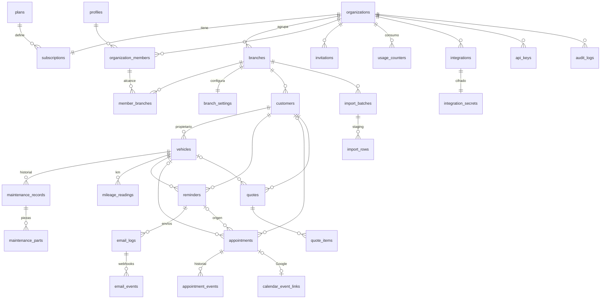

# RevisaYa — Base de datos

> Estado: **diseño (Fase 0)**. Las migraciones SQL se escriben en la Fase 1 a partir de este documento.
> Motor: PostgreSQL (Supabase, región UE). Extensiones: `pgcrypto`, `citext`, `pg_trgm`, `pg_cron`, `pg_net`, `pgtap` (solo tests).

## 1. Convenciones

- Claves primarias `uuid` (`gen_random_uuid()`); `bigint identity` en tablas de log de alto volumen.
- Todas las tablas de negocio llevan `organization_id` y, si pertenecen a un taller, `branch_id`.
- **Coherencia de tenencia mediante FK compuestas**: cada tabla padre expone `unique (organization_id, id)` o `unique (organization_id, branch_id, id)` y las hijas referencian la tupla completa. Es imposible, a nivel de motor, que un vehículo de la organización A apunte a un cliente de la B, o que un registro de la sucursal 1 cuelgue de un cliente de la sucursal 2.
- `organization_id` y `branch_id` son **inmutables** (trigger `forbid_tenant_change` en `UPDATE`).
- `created_at`, `updated_at` (trigger `set_updated_at`) y `deleted_at` (borrado lógico) donde aplique.
- Enumerados como tipos `enum` de Postgres (estados estables) o `text + check` (listas que pueden crecer).
- Dinero: `numeric(12,2)`; cantidades: `numeric(12,3)`; porcentajes: `numeric(5,2)`.
- Fechas de negocio (revisiones) como `date`; instantes como `timestamptz` (UTC). La conversión a hora local usa la zona horaria de la sucursal.
- Esquemas: `public` (tablas), `app` (funciones auxiliares de seguridad, **no expuesto** por la Data API), `private` (secretos, colas internas; sin acceso para `anon`/`authenticated`).

## 2. Diagrama entidad-relación (principal)



## 3. Tablas

### 3.1 Catálogo y facturación de la plataforma

**`plans`** — fuente única de precios, límites y funcionalidades (sembrada por migración, solo lectura para usuarios).

| Columna | Tipo | Notas |
|---|---|---|
| code | text PK | `pro`, `max`, `business`, `excelencia` |
| name | text | |
| price_month_cents / price_year_cents | int | 3900/39000 · 7900/79000 · 14900/149000 · 24900/249000 |
| max_customers | int null | 150 · 800 · null · null (`null` = ilimitado) |
| max_active_vehicles | int null | 300 · 2000 · null · null |
| monthly_emails | int | 500 · 3000 · 15000 · 50000 |
| max_users | int null | 1 · 3 · null · null |
| max_branches | int null | 1 · 1 · 3 · null |
| features | text[] | `date_reminders`, `quotes_pdf`, `import`, `km_reminders`, `google_calendar`, `reports`, `multi_branch`, `priority_support`, `onboarding`, `api`, `custom_templates`, `included_domain`, `account_manager` |
| sort_order, is_public | | |

**`billing_prices`** — `(plan_code, interval ∈ {month, year}, livemode bool) → stripe_price_id` único. Permite tener precios TEST y LIVE sin tocar código.

**`billing_customers`** — `organization_id PK`, `stripe_customer_id unique`, `livemode`.

**`subscriptions`** — una vigente por organización (`unique (organization_id)`), escrita **solo** por el procesador de webhooks.
`plan_code FK`, `status` (`trialing`, `active`, `past_due`, `unpaid`, `canceled`, `incomplete`, `incomplete_expired`, `paused`), `billing_interval`, `stripe_subscription_id unique`, `stripe_price_id`, `trial_start`, `trial_end`, `current_period_start`, `current_period_end`, `cancel_at_period_end`, `canceled_at`, `ended_at`, `livemode`, `updated_at`.

**`billing_invoices`** — historial de pagos: `stripe_invoice_id unique`, `organization_id`, `status`, `amount_due/paid_cents`, `currency`, `period_start/end`, `hosted_invoice_url`, `invoice_pdf_url`, `created_at`.

**`stripe_events`** — idempotencia: `id text PK` (= `evt_…`), `type`, `livemode`, `received_at`, `processed_at`, `status`, `error`.

### 3.2 Identidad, organizaciones y permisos

**`profiles`** (la entidad "users"; las credenciales viven en `auth.users`, con hash gestionado por Supabase)
`id uuid PK FK auth.users on delete cascade`, `first_name`, `last_name`, `email citext` (sincronizado por trigger desde `auth.users`), `status` (`active`, `disabled`), `locale` default `es-ES`, `created_at`, `last_seen_at`.

**`organizations`**
`id`, `slug citext unique` (para la página pública de cita), `trade_name` (nombre comercial), `legal_name`, `tax_id` (CIF/NIF, validado con dígito de control en servidor), `address_line1/2`, `postal_code`, `city`, `province`, `country` default `ES`, `phone`, `email citext`, `logo_path`, `brand_primary`/`brand_secondary` (`check ~ '^#[0-9a-fA-F]{6}$'`), `timezone` default `Europe/Madrid` (validado contra `pg_timezone_names`), `locale` default `es-ES`, `status` (`active`, `suspended`, `pending_deletion`, `deleted`), `data_retention_until date null` (fijado al cancelar), `created_by`, `created_at`, `updated_at`.

**`branches`** (sucursales / talleres)
`id`, `organization_id FK`, `name`, `slug` (`unique (organization_id, slug)`), dirección, `phone`, `email`, `timezone null` (hereda de la organización), `is_primary bool` (índice único parcial: una primaria por organización), `status` (`active`, `archived`), `created_at`. `unique (organization_id, id)`.
Límite de sucursales por plan: trigger `enforce_branch_limit`.

**`organization_members`**
`id`, `organization_id`, `user_id FK profiles`, `role` (`admin`, `operator`), `is_owner bool` (índice único parcial: un propietario por organización; no se puede eliminar ni degradar), `permissions text[]` (solo operarios; `check` contra lista permitida), `branch_scope` (`all`, `selected`), `status` (`active`, `suspended`), `created_at`. `unique (organization_id, user_id)`.

**`member_branches`** — `(member_id, organization_id, branch_id)` PK compuesta; FK compuesta a `branches(organization_id, id)`.

**`invitations`**
`id`, `organization_id`, `email citext`, `role`, `permissions`, `branch_ids uuid[]`, `token_hash bytea unique` (SHA-256 del token; el token en claro solo viaja en el email), `invited_by`, `expires_at` (7 días), `accepted_at`, `revoked_at`. Índice único parcial `(organization_id, email) where accepted_at is null and revoked_at is null`.
Límite de usuarios: miembros activos + invitaciones pendientes ≤ `max_users` (trigger con bloqueo).

Permisos de operario (lista cerrada): `customers.read`, `customers.write`, `customers.delete`, `vehicles.write`, `vehicles.delete`, `maintenance.write`, `imports.run`, `reminders.read`, `appointments.manage`, `quotes.manage`, `reports.read`. Exclusivos de administrador (no asignables): facturación, usuarios, sucursales, integraciones, API keys, plantillas, configuración, exportación/borrado RGPD.

### 3.3 Configuración por sucursal

**`branch_settings`** — `branch_id PK`, `organization_id`:
- `reminders_enabled bool` default `false` (el taller los activa explícitamente, paso 5 del PDF).
- `offsets_days int[]` default `{30,7}` (`check`: 1–5 valores entre 0 y 365, sin duplicados).
- `send_window_start time` default `09:00`, `send_window_end time` default `19:00`.
- `send_weekdays smallint[]` default `{1,2,3,4,5}` (ISO: lunes=1).
- `default_interval_months smallint` default `12`, `default_interval_km int` default `15000` (para calcular la próxima revisión si no se indica).
- `km_reminders_enabled bool` (requiere feature `km_reminders`), `km_offset_before int` default `1000`.
- `booking_enabled bool`, `booking_mode` (`free_request`, `slots`), `slot_minutes`, `booking_notice_hours`.
- `sender_mode` (`shared`, `custom_domain`), `sending_domain_id null`, `reply_to_email`.
- `digest_frequency` (`off`, `daily`, `weekly`) — resumen de avisos enviados para el taller.

**`blackout_dates`** — `(branch_id, date)` PK, `organization_id`, `reason` (festivos y cierres).
**`availability_rules`** — `branch_id`, `weekday`, `start_time`, `end_time`, `capacity` (solo `booking_mode = slots`).

### 3.4 Clientes, vehículos e historial

**`customers`**
`id`, `organization_id`, `branch_id` (FK compuesta a `branches`), `first_name`, `last_name`, `email citext null` (formato validado), `phone text null` (normalizado E.164), `source` (`manual`, `import`, `booking_page`, `api`, `walk_in`, `referral`, `other`), `notes` (internas, máx. 5.000), `reminders_opt_out bool`, `opted_out_at`, `import_batch_id null`, `created_by`, `created_at`, `updated_at`, `deleted_at`.
`unique (organization_id, branch_id, id)`. Índices: `(organization_id, branch_id, created_at desc)`, `(organization_id, lower(email))`, GIN trigram sobre `first_name || ' ' || last_name` para búsqueda rápida.
Límite de clientes: trigger `enforce_customer_limit` (bloqueo por organización + recuento de no borrados).
No se fuerza email único (familias que comparten correo); la duplicidad se detecta como **aviso** en UI e importación.

**`vehicles`**
`id`, `organization_id`, `branch_id`, `customer_id` → FK compuesta `(organization_id, branch_id, customer_id) → customers(organization_id, branch_id, id)`, `plate` (como la escribió el taller), `plate_normalized` (columna generada: mayúsculas sin espacios, guiones ni puntos), `make`, `model`, `vin null` (17 caracteres, sin I/O/Q), `current_km int check ≥ 0`, `km_updated_at`, `last_service_date date`, `last_service_km int`, `next_service_date date`, `next_service_km int`, `next_service_source` (`manual`, `computed`, `import`), `status` (`active`, `inactive`, `sold`, `scrapped`), `import_batch_id`, `created_at`, `updated_at`, `deleted_at`.
- **Unicidad**: `unique (branch_id, plate_normalized) where deleted_at is null`. Sin restricción entre organizaciones ni entre sucursales distintas (decisión pendiente, ver P2 en DECISIONES-TECNICAS).
- Índice del planificador: `(organization_id, branch_id, next_service_date) where status = 'active' and deleted_at is null`.
- Límite de vehículos **activos**: trigger en `insert` y en `update of status` (reactivar cuenta).
- `last_service_*` y `next_service_*` están desnormalizados para rendimiento; los mantiene un trigger al insertar/editar historial (solo si el registro es el más reciente). Cambiar el propietario conserva el historial (el historial cuelga del vehículo).

**`maintenance_records`** (historial)
`id`, `organization_id`, `branch_id`, `vehicle_id` (FK compuesta), `customer_id_snapshot` (propietario en ese momento), `service_date date` (`check` ≤ hoy + 1 día; ≥ 1950-01-01), `km int check ≥ 0`, `work_performed text not null`, `notes`, `next_recommended_date date` (`check` > `service_date`), `next_recommended_km int`, `created_by FK profiles`, `created_at`, `updated_at`.
Índice `(vehicle_id, service_date desc)`. Ediciones y borrados quedan en `audit_logs`.

**`maintenance_parts`** — `id`, `organization_id`, `record_id` (FK compuesta), `description`, `reference null`, `quantity numeric(12,3) check > 0`.

**`mileage_readings`** — `id`, `organization_id`, `vehicle_id`, `km`, `read_on date`, `source` (`maintenance`, `manual`, `import`, `appointment`). Base para estimar kilometraje (ver AUTOMATIZACIONES). Una lectura menor que la anterior genera un **aviso** (cambio de cuadro), no un bloqueo.

### 3.5 Recordatorios y correo

**`reminders`**
`id`, `organization_id`, `branch_id`, `customer_id`, `vehicle_id` (FK compuestas), `type` (`service_date`, `service_km`), `due_date date` (fecha prevista de revisión, real o estimada), `offset_days int`, `scheduled_for timestamptz`, `status` (`scheduled`, `processing`, `retrying`, `sent`, `delivered`, `bounced`, `complained`, `failed`, `skipped`, `canceled`), `skip_reason` (`no_email`, `opted_out`, `suppressed`, `quota_exceeded`, `subscription_inactive`, `feature_unavailable`, `superseded`, `reminders_disabled`), `attempts smallint`, `max_attempts smallint` default 5, `next_attempt_at`, `locked_until`, `locked_by`, `provider`, `provider_message_id`, `sent_at`, `last_error` (código + mensaje saneado), `booking_token_hash bytea unique null`, `booking_token_expires_at`, `created_at`, `updated_at`.
**Idempotencia del evento**: `unique (vehicle_id, type, due_date, offset_days)`. Una segunda ejecución del planificador no puede crear el mismo recordatorio.
Índice del dispatcher: `(status, scheduled_for) where status in ('scheduled','processing','retrying')` e `(organization_id, status, created_at desc)` para el panel.

**`email_templates`** — `id`, `organization_id`, `branch_id null` (null = toda la organización), `kind` (`reminder_service_date`, `reminder_service_km`, `booking_received`, `booking_confirmed`, `booking_rejected`, `booking_rescheduled`), `subject` (máx. 200), `body` (texto con variables, máx. 5.000), `button_label`, `button_enabled`, `status` (`active`, `draft`), `version int`, `updated_by`, `updated_at`. Índice único parcial `(organization_id, coalesce(branch_id, …), kind)`.
"Restaurar plantilla original" = borrar la personalización: las plantillas por defecto viven versionadas en código. Variables permitidas en lista cerrada (ver INTEGRACIONES §2).

**`sending_domains`** — `id`, `organization_id`, `domain citext`, `from_local_part`, `provider`, `provider_domain_id`, `status` (`pending`, `verified`, `failed`, `temporary_failure`), `dns_records jsonb` (registros que debe crear el taller), `verified_at`, `last_checked_at`. `unique (organization_id, domain)`.

**`email_logs`** — `id bigint identity`, `organization_id`, `branch_id`, `reminder_id null`, `appointment_id null`, `customer_id null`, `vehicle_id null`, `kind`, `to_email citext`, `from_email`, `reply_to`, `subject`, `provider`, `provider_message_id`, `status` (`accepted`, `delivered`, `delivery_delayed`, `bounced`, `complained`, `failed`), `bounce_type`, `error_code`, `error_message`, `sent_at`, `delivered_at`, `opened_at null` (solo si hay seguimiento), `created_at`. `unique (provider, provider_message_id)`. Índices `(organization_id, created_at desc)`, `(reminder_id)`. Particionado mensual a partir de cierto volumen.

**`email_events`** — `id`, `provider`, `provider_event_id unique` (idempotencia de webhooks), `email_log_id`, `type`, `occurred_at`, `payload_min jsonb` (sin cuerpo del correo).

**`email_suppressions`** — `(organization_id, email)` PK, `reason` (`hard_bounce`, `complaint`, `unsubscribe`, `manual`), `source_event_id`, `created_at`. Se consulta antes de cada envío.

### 3.6 Citas

**`appointments`** — una tabla con máquina de estados explícita; **solicitud ≠ cita confirmada**.
`id`, `organization_id`, `branch_id`, `customer_id null`, `vehicle_id null` (FK compuestas; null si la solicitud llega desde la página genérica y aún no se ha vinculado), `reminder_id null`, `source` (`reminder_link`, `booking_page`, `manual`, `api`), `requester_name`, `requester_email`, `requester_phone`, `plate_entered`, `requested_date date`, `requested_slot tstzrange null`, `customer_message`, `status` (`requested`, `confirmed`, `rejected`, `canceled`, `completed`, `no_show`), `confirmed_start`, `confirmed_end`, `internal_notes`, `decided_by`, `decided_at`, `created_at`, `updated_at`.
`check (status <> 'confirmed' or confirmed_start is not null)`. Índices `(organization_id, branch_id, status, requested_date)`.

**`appointment_events`** — historial de cambios de estado/fecha: `appointment_id`, `from_status`, `to_status`, `old_start`, `new_start`, `actor_user_id`, `created_at`.

**`calendar_event_links`** — `appointment_id unique`, `integration_id`, `google_calendar_id`, `google_event_id`, `etag`, `sync_status`, `last_synced_at`, `last_error`. La unicidad de `appointment_id` impide eventos duplicados.

### 3.7 Presupuestos

**`quotes`** — `id`, `organization_id`, `branch_id`, `customer_id`, `vehicle_id null` (FK compuestas), `series_year smallint`, `sequence int`, `number text` (p. ej. `P-2026-0042`, `unique (branch_id, series_year, sequence)`), `issue_date`, `valid_until` (`check ≥ issue_date`), `status` (`draft`, `sent`, `accepted`, `rejected`, `expired`), `subtotal`, `tax_total`, `total` (`check total = subtotal + tax_total`), `currency` default `EUR`, `notes`, `pdf_path`, `snapshot jsonb` (datos de taller/cliente/vehículo congelados al emitir), `created_by`, `created_at`, `updated_at`.
**`quote_items`** — `id`, `organization_id`, `quote_id` (FK compuesta), `position`, `description`, `quantity numeric(12,3) > 0`, `unit_price numeric(12,2) ≥ 0` (sin IVA), `tax_rate numeric(5,2) in (0, 4, 10, 21)`, `line_subtotal`, `line_tax`, `line_total`.
**`document_sequences`** — `(branch_id, doc_type, year)` PK, `last_value`; se incrementa con `update … returning` dentro de la transacción (sin huecos por concurrencia).
Los cálculos se hacen en servidor con `decimal.js` (redondeo *half-up* a 2 decimales por línea) y la BD verifica la suma.

### 3.8 Consumo y límites

**`usage_counters`** (la entidad "usage_records") — `(organization_id, resource, period_start date)` PK, `used int check ≥ 0`, `limit_snapshot int null`, `updated_at`. Recurso medido: `emails` (mensual). Clientes, vehículos activos, usuarios y sucursales no se cuentan con contadores: se cuentan en vivo bajo bloqueo (siempre coherentes, sin derivas).
Reserva atómica de un envío:
```sql
insert into usage_counters (organization_id, resource, period_start, used, limit_snapshot)
values ($org, 'emails', $period, 1, $limit)
on conflict (organization_id, resource, period_start)
do update set used = usage_counters.used + 1, limit_snapshot = excluded.limit_snapshot
where usage_counters.used < excluded.limit_snapshot
returning used;   -- sin fila devuelta ⇒ límite alcanzado
```
El periodo es el **mes natural en la zona horaria de la organización** (P4). Un cambio de plan cambia el límite aplicable pero **no reinicia** `used`.

### 3.9 Integraciones y API

**`integrations`** — `id`, `organization_id`, `branch_id null`, `type` (`google_calendar`), `status` (`connected`, `error`, `revoked`, `disconnected`), `external_account_email`, `scopes text[]`, `calendar_id`, `connected_by`, `connected_at`, `last_sync_at`, `last_error`.
**`integration_secrets`** (esquema `private`) — `integration_id PK`, `ciphertext bytea`, `nonce bytea`, `key_version smallint`, `updated_at`. Cifrado AES-256-GCM en la aplicación; sin acceso para `authenticated`.
**`api_keys`** — `id`, `organization_id`, `name`, `prefix` (visible, p. ej. `ry_test_ab12cd34`), `key_hash bytea unique` (HMAC-SHA-256 con *pepper* de servidor), `scopes text[]`, `created_by`, `last_used_at`, `expires_at`, `revoked_at`.
**`api_request_logs`** — muestreo de peticiones (`organization_id`, `api_key_id`, `method`, `route`, `status`, `latency_ms`, `created_at`), retención 30 días.

### 3.10 Importación

**`import_batches`** — `id`, `organization_id`, `branch_id`, `uploaded_by`, `file_name`, `file_sha256`, `storage_path`, `row_count`, `status` (`uploaded`, `parsing`, `validated`, `has_errors`, `committing`, `committed`, `failed`, `canceled`, `expired`), `summary jsonb`, `error_count`, `warning_count`, `created_at`, `committed_at`, `expires_at` (staging se purga a los 7 días).
**`import_rows`** — `(batch_id, row_number)` PK, `organization_id`, `raw jsonb`, `normalized jsonb`, `errors jsonb`, `warnings jsonb`, `action` (`create_customer_and_vehicle`, `attach_to_existing_customer`, `skip_duplicate`), `matched_customer_id`, `matched_vehicle_id`.

### 3.11 Operación, auditoría y RGPD

**`jobs`** (esquema `private`) — cola genérica: `id`, `type`, `organization_id null`, `payload jsonb`, `idempotency_key text unique`, `run_at`, `status`, `attempts`, `max_attempts`, `locked_until`, `locked_by`, `last_error`, `created_at`. Para sincronización de calendario, exportaciones, purgas, PDFs y resúmenes.
**`job_runs`** — `id`, `job_name`, `started_at`, `finished_at`, `status`, `stats jsonb`, `error`. Monitorización.
**`audit_logs`** — `id bigint identity`, `organization_id`, `actor_type` (`user`, `system`, `api_key`, `stripe`), `actor_id`, `action` (p. ej. `customer.deleted`), `resource_type`, `resource_id`, `metadata jsonb` (sin datos personales ni secretos), `ip_truncated`, `created_at`. **Solo inserción**: sin políticas de `update`/`delete`.
**`data_subject_requests`** — `id`, `organization_id`, `customer_id null`, `type` (`access`, `rectification`, `erasure`, `restriction`, `portability`, `objection`), `status`, `requested_at`, `due_at` (1 mes), `completed_at`, `handled_by`, `notes`.
**`legal_acceptances`** — `user_id`, `organization_id`, `document` (`terms`, `privacy`, `dpa`), `version`, `accepted_at`, `ip_truncated`.
**`rate_limit_buckets`** (esquema `private`) — implementación inicial del limitador en Postgres.

## 4. Políticas de borrado

| Relación | Regla | Motivo |
|---|---|---|
| organización → todo | `on delete restrict`; el borrado lo hace un job de purga tras el periodo de retención | Nunca borrar en cascada por accidente desde la app. |
| cliente → vehículos | `restrict`. Borrar un cliente con vehículos exige confirmar (el servicio borra lógicamente cliente + vehículos en una transacción) | "Eliminar con controles de seguridad". |
| vehículo → historial, recordatorios | `restrict`; el vehículo se archiva (`status`) o se borra lógicamente | El historial se conserva. |
| recordatorio → email_logs | `set null` | Los logs sobreviven a la purga del recordatorio. |
| cita → vehículo/cliente | `set null` | Una cita puede quedar sin vincular. |
| perfil → membresías | `cascade`; → `maintenance_records.created_by` `set null` | Borrar un usuario no borra historial. |

Borrado lógico (`deleted_at`) → purga definitiva por job a los 30 días. Supresión RGPD → anonimización/borrado inmediato de ese titular, con registro en `data_subject_requests`.

## 5. Matriz RLS

`A` = administrador · `O` = operario (según permisos y sucursales asignadas) · `S` = servidor con rol de sistema (jobs/webhooks, scoping explícito) · `—` = denegado.

| Tabla | SELECT | INSERT | UPDATE | DELETE |
|---|---|---|---|---|
| plans | todos (incl. anon) | — | — | — |
| organizations | miembros | S (registro) | A | — (S purga) |
| branches | miembros con alcance | A | A | — |
| organization_members, invitations | A; O solo su fila | A | A (no propietario) | A (no propietario) |
| branch_settings, blackout_dates, availability_rules | miembros con alcance | A | A | A |
| customers, vehicles | O/A con alcance | `*.write` | `*.write` | `*.delete` (lógico) |
| maintenance_records/parts, mileage_readings | O/A con alcance | `maintenance.write` | `maintenance.write` | A |
| reminders | `reminders.read` | S | S (A: cancelar) | — |
| email_templates, sending_domains | miembros | A | A | A |
| email_logs, email_events, email_suppressions | `reminders.read` | S | S | A (suppressions) |
| appointments, appointment_events | `appointments.manage` | S (público) / O/A | `appointments.manage` | — |
| quotes, quote_items, document_sequences | `quotes.manage` | `quotes.manage` | `quotes.manage` (solo `draft` editable) | A (solo `draft`) |
| subscriptions, billing_*, usage_counters | A | S | S | — |
| integrations | A | S | S | A |
| integration_secrets, jobs, rate_limit_buckets | — | — | — | — (solo S) |
| api_keys | A (sin hash) | A | A (revocar) | — |
| import_batches/rows | `imports.run` | `imports.run` | `imports.run` | `imports.run` |
| audit_logs | A | S / trigger | — | — |

Funciones auxiliares (`app`, `security definer`, `stable`, `set search_path = ''`, invocadas como `(select app.fn(...))` para que Postgres las evalúe una vez por consulta):
`app.uid()`, `app.is_member(org)`, `app.is_admin(org)`, `app.can_access_branch(org, branch)`, `app.has_permission(org, perm)`.
Ninguna política confía en un `organization_id` enviado por el cliente: todas comparan con las membresías reales del `auth.uid()` verificado.

## 6. Comprobaciones previas a cerrar el esquema (checklist de la Fase 1)

- [ ] Todas las relaciones con FK; las de tenencia, compuestas.
- [ ] Ninguna tabla con datos de cliente sin `organization_id` + RLS activada y forzada (`force row level security`).
- [ ] Índices: toda FK indexada; índices compuestos encabezados por `organization_id`.
- [ ] Unicidades: matrícula por sucursal, recordatorio por evento, mensaje por proveedor, evento de webhook, número de presupuesto.
- [ ] Triggers de límites probados con concurrencia (dos transacciones simultáneas no superan el límite).
- [ ] Inmutabilidad de `organization_id`/`branch_id` probada.
- [ ] Reglas de borrado probadas (sin cascadas accidentales).
- [ ] pgTAP: un usuario de la organización A no lee/escribe/borra nada de B; un operario sin permiso no escribe; `anon` no ve nada salvo `plans`.
