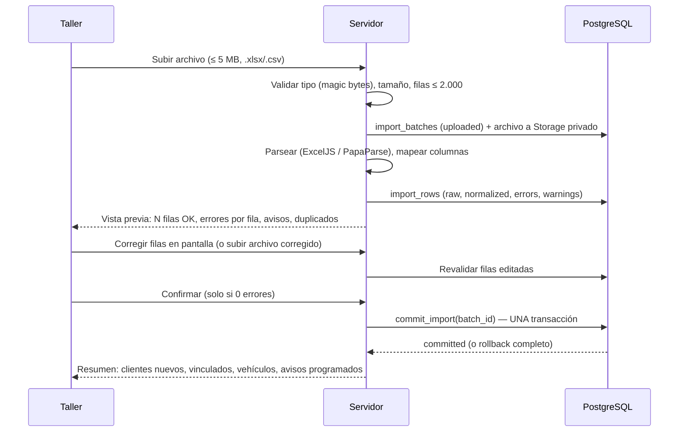

# RevisaYa — Importación Excel/CSV

> Estado: **diseño (Fase 0)**. Implementación en la Fase 4.

## 1. Plantilla (según el PDF)

| Columna | Obligatoria | Validación |
|---|---|---|
| Nombre del cliente | Sí | 1–120 caracteres. Se separa en nombre/apellidos por el primer espacio (editable después). |
| Correo electrónico | Sí, para avisos por correo | Formato RFC + dominio con punto; minúsculas. Vacío → ver regla R4. |
| Teléfono | No | Normalizado a E.164 (+34 por defecto). |
| Matrícula | Sí | Normalizada (mayúsculas, sin espacios/guiones). Ver §3. |
| Marca | No | ≤ 60. |
| Modelo | No | ≤ 60. |
| Última revisión | Sí | `dd/mm/aaaa` o fecha nativa de Excel. No futura. ≥ 1950. |
| Kilómetros | No | Entero 0–2.000.000. Admite separador de miles (`82.000`). |
| Próxima revisión | No | `dd/mm/aaaa`, posterior a la última revisión. Si falta: última + `default_interval_months`. |

La plantilla descargable es un `.xlsx` generado por el servidor con encabezados, una fila de ejemplo (la del PDF: *Laura Martín · laura@correo.com · 600123456 · 1234ABC · Seat · Ibiza · 15/03/2026 · 82000*), formato de celdas de fecha y una hoja de instrucciones. La fila de ejemplo se detecta y se ignora si no se ha borrado.

## 2. Flujo

## 3. Reglas de validación

- **R1 Filas vacías**: se ignoran sin error y se informan en el resumen.
- **R2 Fechas**: solo `dd/mm/aaaa` (también `d/m/aaaa`, `dd-mm-aaaa`) o número de serie de Excel. Nunca se interpreta `mm/dd`. Fechas imposibles (31/02) → error.
- **R3 Kilómetros**: negativos, decimales o texto → error.
- **R4 Correo vacío** (propuesta, P3): error bloqueante por defecto, como dice el PDF ("correo vacío" aparece en la revisión de errores). El taller puede marcar explícitamente esas filas como "importar sin correo (no recibirá avisos)", y entonces pasan a aviso. Nunca se importa a medias sin esa decisión explícita.
- **R5 Matrícula**: se acepta el formato actual (`0000BBB`, sin vocales ni Ñ/Q), el provincial antiguo (`M1234AB`, `B1234A`), ciclomotor (`C1234BBB`) y otros (históricos, temporales, extranjeros) entre 4 y 10 caracteres alfanuméricos **con aviso** ("formato no reconocido, revísalo"). Caracteres no alfanuméricos → error.
- **R6 Duplicados dentro del archivo**: misma matrícula dos veces → error en la segunda fila.
- **R7 Duplicados contra la BD**: matrícula existente en la sucursal → la fila se marca `skip_duplicate` (aviso) con opción de "actualizar datos del vehículo existente" en una versión posterior; por defecto no se sobrescribe nada.
- **R8 Agrupación de clientes**: filas con el mismo email normalizado (o, sin email, mismo nombre + teléfono) se agrupan en **un único cliente con varios vehículos**. Si el email ya existe en la sucursal se vincula al cliente existente (aviso visible).
- **R9 Límites del plan**: antes de confirmar se calcula si los clientes y vehículos nuevos superan el límite; si es así, error global con el exceso exacto. La BD lo vuelve a comprobar dentro de la transacción.
- **R10 Doble importación**: si el `sha256` del archivo coincide con una importación ya confirmada de la sucursal, se avisa y se exige confirmación explícita; en cualquier caso R7 impide crear vehículos duplicados.

## 4. Confirmación atómica

`commit_import(batch_id)` es una función de servidor que, dentro de **una sola transacción**:
1. Bloquea el lote (`select … for update`) y comprueba `status = 'validated'` y 0 errores (evita doble clic / doble confirmación).
2. Inserta clientes, vehículos, registros de historial (la "última revisión" crea un `maintenance_record` con trabajos "Revisión importada") y lecturas de km.
3. Ejecuta los triggers de límites y restricciones.
4. Marca el lote `committed` y escribe `audit_logs`.

Cualquier error → `rollback` completo: no queda ninguna ficha. El planner programará los avisos en su siguiente ejecución (o se lanza un job inmediato para la sucursal).

## 5. Informe de errores

Descargable en CSV y XLSX con las columnas originales + `fila`, `errores`, `avisos`. Celdas protegidas contra inyección de fórmulas. Se puede corregir ese archivo y volver a subirlo.

## 6. Detalles prácticos

- CSV: detección de separador (`;` es el habitual del Excel en español, también `,` y tabulador) y de codificación (UTF-8 con/sin BOM y Windows-1252, habitual al exportar desde Excel en España).
- Encabezados tolerantes: sin distinción de mayúsculas/tildes y con alias (`email`, `e-mail`, `correo`; `km`, `kilómetros`…).
- `.xls` (Excel 97-2003) no se admite: se pide guardar como `.xlsx` o CSV (se documenta la decisión).
- Seguridad: límite de tamaño descomprimido para .xlsx, sin evaluar fórmulas (se lee el valor cacheado), archivos en bucket privado y borrados a los 7 días.
