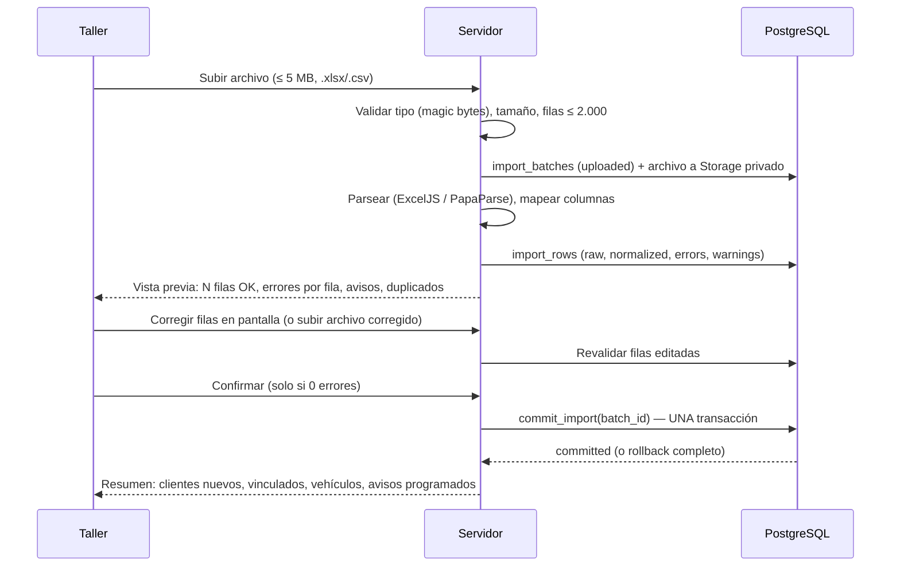

# RevisaYa — Importación Excel/CSV

> Estado: **implementado (Fase 4)**. Código: `src/lib/imports/` (columnas, validación pura, mensajes), `src/server/modules/imports/` (lectura de archivos, staging, confirmación, plantilla e informe), migración `20261105000300_imports_commit.sql` (`app.commit_import`). Ajustes respecto al diseño: §7.

## 1. Plantilla (según el PDF)

| Columna | Obligatoria | Validación |
|---|---|---|
| Nombre del cliente | Sí | 1–120 caracteres. Se separa en nombre/apellidos por el primer espacio (editable después). |
| Correo electrónico | Sí, para avisos por correo | Formato RFC + dominio con punto; minúsculas. Vacío → ver regla R4. |
| Teléfono | No | Normalizado a E.164 (+34 por defecto). |
| Matrícula | Sí | Normalizada (mayúsculas, sin espacios/guiones). Ver §3. |
| Marca | No | ≤ 60. |
| Modelo | No | ≤ 60. |
| Última revisión | Sí | `dd/mm/aaaa` o fecha nativa de Excel. No futura. ≥ 1950. |
| Kilómetros | No | Entero 0–2.000.000. Admite separador de miles (`82.000`). |
| Próxima revisión | No | `dd/mm/aaaa`, posterior a la última revisión. Si falta: última + `default_interval_months`. |

La plantilla descargable es un `.xlsx` generado por el servidor con encabezados, una fila de ejemplo (la del PDF: *Laura Martín · laura@correo.com · 600123456 · 1234ABC · Seat · Ibiza · 15/03/2026 · 82000*), formato de celdas de fecha y una hoja de instrucciones. La fila de ejemplo se detecta y se ignora si no se ha borrado.

## 2. Flujo

## 3. Reglas de validación

- **R1 Filas vacías**: se ignoran sin error y se informan en el resumen.
- **R2 Fechas**: solo `dd/mm/aaaa` (también `d/m/aaaa`, `dd-mm-aaaa`) o número de serie de Excel. Nunca se interpreta `mm/dd`. Fechas imposibles (31/02) → error.
- **R3 Kilómetros**: negativos, decimales o texto → error.
- **R4 Correo vacío** (propuesta, P3): error bloqueante por defecto, como dice el PDF ("correo vacío" aparece en la revisión de errores). El taller puede marcar explícitamente esas filas como "importar sin correo (no recibirá avisos)", y entonces pasan a aviso. Nunca se importa a medias sin esa decisión explícita.
- **R5 Matrícula**: se acepta el formato actual (`0000BBB`, sin vocales ni Ñ/Q), el provincial antiguo (`M1234AB`, `B1234A`), ciclomotor (`C1234BBB`) y otros (históricos, temporales, extranjeros) entre 4 y 10 caracteres alfanuméricos **con aviso** ("formato no reconocido, revísalo"). Caracteres no alfanuméricos → error.
- **R6 Duplicados dentro del archivo**: misma matrícula dos veces → error en la segunda fila.
- **R7 Duplicados contra la BD**: matrícula existente en la sucursal → la fila se marca `skip_duplicate` (aviso) y no se importa. **Implementado (2026-11-06)**: con la opción del lote «Completar los vehículos existentes con estos datos», la fila pasa a `update_existing_vehicle` y, en la misma confirmación atómica, **completa** el vehículo **sin sobrescribir nada**:
  - marca y modelo, solo si faltaban;
  - la revisión entra en el historial solo si es más reciente que la última (y recalcula la próxima);
  - los kilómetros, solo si son mayores (lectura de tipo `import`);
  - el correo y el teléfono del propietario, solo si los tenía vacíos.

  Esas filas sí se validan (sus errores bloquean).
- **R8 Agrupación de clientes**: filas con el mismo email normalizado (o, sin email, mismo nombre + teléfono) se agrupan en **un único cliente con varios vehículos**. Si el email ya existe en la sucursal se vincula al cliente existente (aviso visible).
- **R9 Límites del plan**: antes de confirmar se calcula si los clientes y vehículos nuevos superan el límite; si es así, error global con el exceso exacto. La BD lo vuelve a comprobar dentro de la transacción.
- **R10 Doble importación**: si el `sha256` del archivo coincide con una importación ya confirmada de la sucursal, se avisa y se exige confirmación explícita; en cualquier caso R7 impide crear vehículos duplicados.

## 4. Confirmación atómica

`commit_import(batch_id)` es una función de servidor que, dentro de **una sola transacción**:
1. Bloquea el lote (`select … for update`) y comprueba `status = 'validated'` y 0 errores (evita doble clic / doble confirmación).
2. Inserta clientes, vehículos, registros de historial (la "última revisión" crea un `maintenance_record` con trabajos "Revisión importada") y lecturas de km.
3. Ejecuta los triggers de límites y restricciones.
4. Marca el lote `committed` y escribe `audit_logs`.

Cualquier error → `rollback` completo: no queda ninguna ficha. El planner programará los avisos en su siguiente ejecución (o se lanza un job inmediato para la sucursal).

## 5. Informe de errores

Descargable en CSV y XLSX con las columnas originales + `fila`, `errores`, `avisos`. Celdas protegidas contra inyección de fórmulas. Se puede corregir ese archivo y volver a subirlo.

## 6. Detalles prácticos

- CSV: detección de separador (`;` es el habitual del Excel en español, también `,` y tabulador) y de codificación (UTF-8 con/sin BOM y Windows-1252, habitual al exportar desde Excel en España).
- Encabezados tolerantes: sin distinción de mayúsculas/tildes y con alias (`email`, `e-mail`, `correo`; `km`, `kilómetros`…).
- `.xls` (Excel 97-2003) no se admite: se pide guardar como `.xlsx` o CSV (se documenta la decisión).
- Seguridad: límite de tamaño descomprimido para .xlsx, sin evaluar fórmulas (se lee el valor cacheado), archivos en bucket privado y borrados a los 7 días.

## 7. Implementación (Fase 4) y ajustes respecto al diseño

| Tema | Cómo quedó |
|---|---|
| Pantallas | `/app/importar` (plantilla, subida, historial de importaciones) y `/app/importar/[id]` (resumen, filas con errores/avisos/todas, corregir fila en pantalla, excluir/incluir fila, informe CSV/XLSX, confirmar, descartar). |
| Archivo original | **No se guarda** en Storage: solo las filas en staging (`import_rows`), que se purgan a los 7 días (`private.purge_expired_data`). Menos copias de datos personales. |
| R4 correo vacío | Opción **por importación**: «Importar también las filas sin correo» convierte el error en aviso para todas las filas sin correo (más simple que marcar fila a fila). |
| Excluir filas | Una fila excluida no se importa ni bloquea la confirmación (`skip_excluded`). |
| R7 vehículo existente | La fila se omite (`skip_duplicate`) y sus otros errores no bloquean, porque no se importa. Con «Completar los vehículos existentes» se valida y completa el vehículo (ver R7). |
| Separador CSV | Detección propia en la línea de cabecera (la automática de PapaParse fallaba con pocas columnas y líneas vacías al final). |
| Confirmación | `app.commit_import` (SECURITY INVOKER: con RLS, permisos y triggers de límites del usuario). Bloquea el lote (`FOR UPDATE`), comprueba estado, errores, caducidad y archivo repetido, e inserta clientes, vehículos y la última revisión de cada vehículo con **una sentencia por tabla**. Cualquier fallo revierte todo. 2.000 filas: ~0,1 s de staging y ~1,2 s de confirmación en local. |
| Límites del plan | Comprobación previa visible en la vista previa (cuántos caben) y comprobación definitiva de la BD al confirmar. |
| Concurrencia | Dos confirmaciones simultáneas del mismo lote: una importa y la otra recibe «ya confirmada». Si alguien registra una matrícula entre la validación y la confirmación, la confirmación falla entera por el índice único. |
| Seguridad del archivo | Tipo por contenido (no extensión), máximo 5 MB (Server Actions a 5,2 MB), tamaño descomprimido del ZIP comprobado antes de abrirlo (≤ 60 MB), sin evaluar fórmulas, `.xls` rechazado con instrucciones, informe CSV protegido contra inyección de fórmulas, rate limiting de 30 subidas/hora por taller. |
